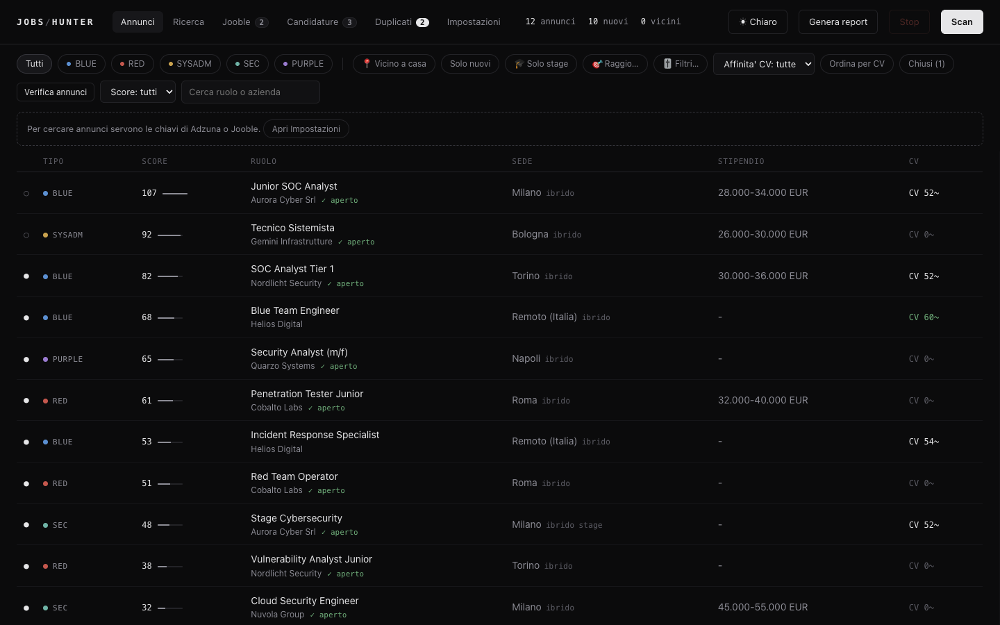
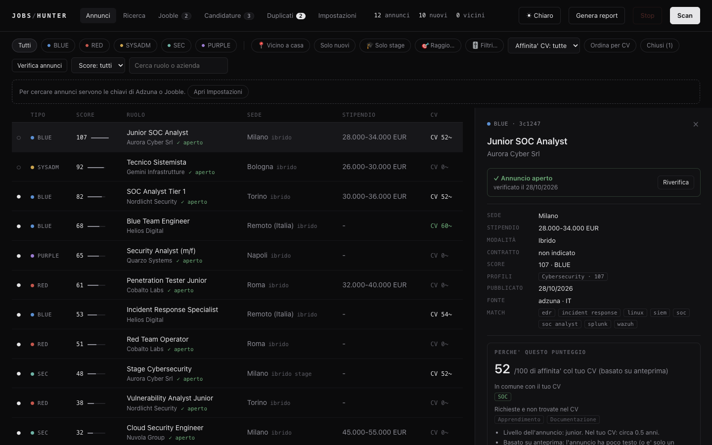
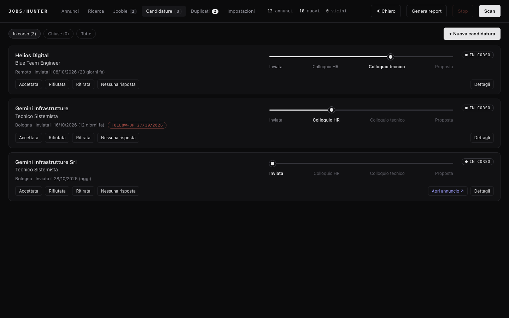
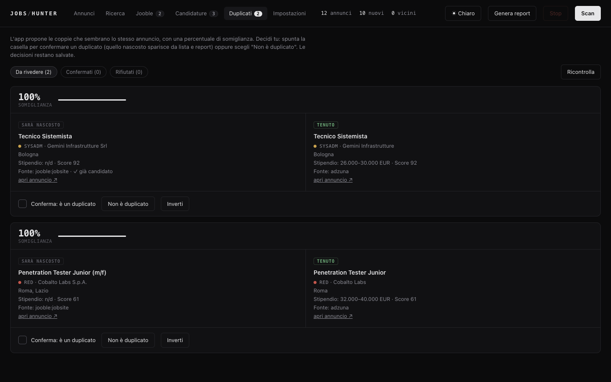
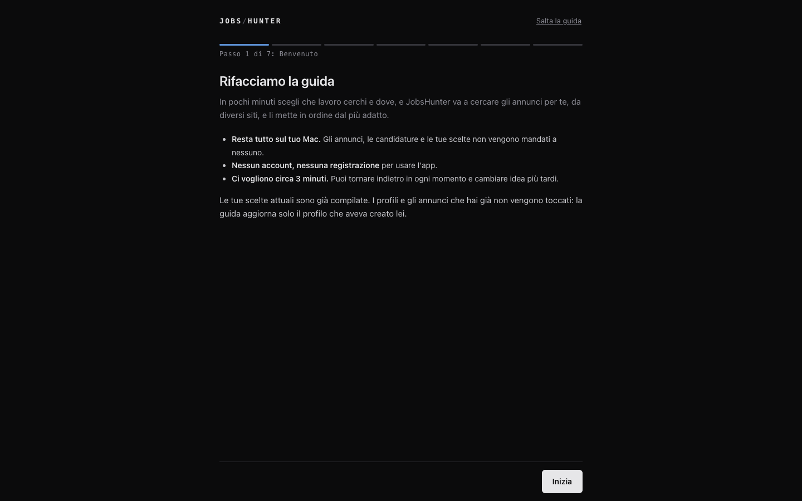
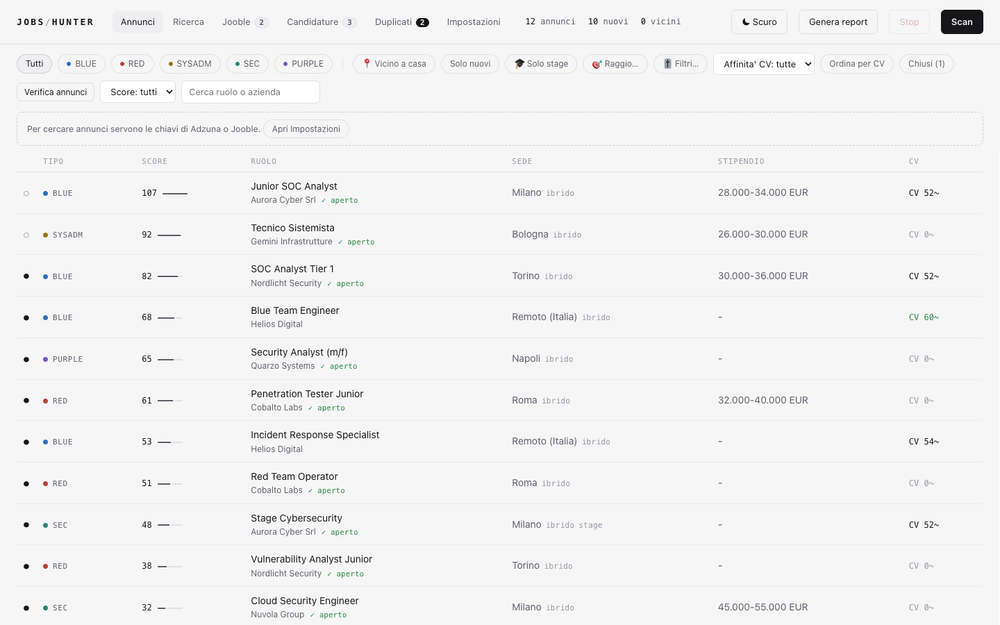
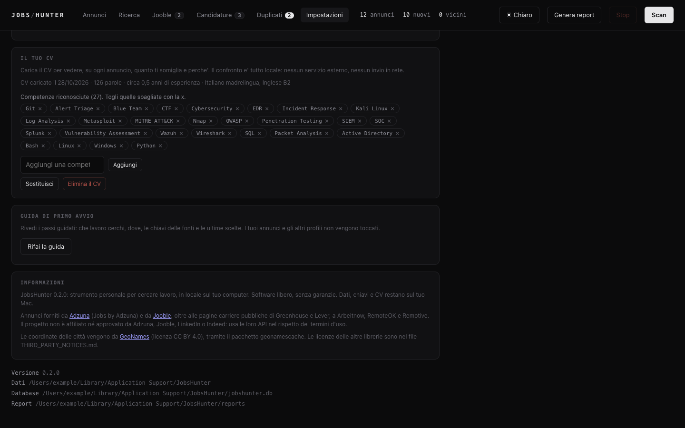

# JobsHunter

**Italiano** | [English](README.en.md)

Un radar personale per annunci di lavoro: **per qualsiasi settore e in più paesi**, in locale sul tuo Mac. Nato per la cybersecurity
(Blue e Red team) e per tecnici e sistemisti, oggi la ricerca si imposta con **profili** (cybersecurity è uno dei tipi, ma puoi cercare
"infermiere", "sviluppatore backend", "magazziniere"...). Raccoglie annunci da più fonti, li valuta, toglie i doppioni, controlla che siano
ancora aperti, ti fa seguire le candidature e genera un report Markdown (per esempio per Obsidian).

Funziona sul tuo computer, con dati e chiavi solo tuoi, senza account e senza telemetria. Si usa come **app per Mac**, da una GUI nel browser
o da riga di comando.

> **Non affiliato** ad Adzuna, Jooble, LinkedIn o Indeed. Leggi le [Avvertenze](#avvertenze) prima di usarlo.
> Licenza: **MIT** (vedi [Licenza](#licenza)). Versione 0.3.0.



---

## Indice

1. [A cosa serve](#a-cosa-serve)
2. [Profili di ricerca e paesi](#profili-di-ricerca-e-paesi)
3. [Come funziona](#come-funziona)
4. [Installazione](#installazione)
5. [Configurazione](#configurazione)
6. [Uso](#uso)
7. [Primo avvio](#primo-avvio)
8. [Personalizzare il punteggio](#personalizzare-il-punteggio)
9. [Report per Obsidian](#report-per-obsidian)
10. [App per Mac e finestra nativa](#app-per-mac)
11. [Scan automatico](#scan-automatico)
12. [Sicurezza e privacy](#sicurezza-e-privacy)
13. [Stato del progetto e prossimi passi](#stato-del-progetto-e-prossimi-passi)
14. [Limiti noti](#limiti-noti)
15. [Struttura del progetto](#struttura-del-progetto)
16. [Risoluzione problemi](#risoluzione-problemi)
17. [Sviluppo e test](#sviluppo-e-test)
18. [Note sulle fonti e crediti](#note-sulle-fonti-e-crediti)
19. [Avvertenze](#avvertenze)
20. [Licenza](#licenza)

---

## A cosa serve

Cercare lavoro a mano significa aprire dieci siti, rileggere gli stessi annunci, perdere quelli nuovi e scoprire dopo che erano chiusi.
JobsHunter fa il lavoro ripetitivo al posto tuo:

- **cerca per profili**: dici che lavoro vuoi, dove e a che livello (anche stage e tirocini), e cerca su più fonti e più paesi;
- **valuta** ogni annuncio con un punteggio per profilo, premiando ciò che cerchi e penalizzando il resto;
- **toglie i doppioni** (lo stesso annuncio su più siti): propone le coppie con una percentuale, decidi tu;
- **controlla che l'annuncio sia ancora aperto**, e nasconde quelli chiusi;
- **filtra** per distanza da una città, modalità di lavoro, tipo di contratto, azienda, città e RAL;
- **ti segue nelle candidature**: tappe (HR, tecnico, proposta), esiti, storico e promemoria;
- **lavora da solo**: scansioni pianificate anche con l'app chiusa, notifiche e un riquadro "novità dall'ultimo accesso";
- **scrive un report** con il testo completo degli annunci e il link per candidarti.

### Com'è fatto

| | |
|---|---|
|  |  |
| La scheda di un annuncio: stato, testo, e quanto somiglia al tuo CV (affinità 0-100 spiegata). | Le candidature, con tappe, esito e promemoria di follow-up. |
|  |  |
| I duplicati: il programma propone, decidi tu. | La guida di primo avvio, in sette passi. |
|  |  |
| Tema chiaro (c'è anche quello scuro). | Impostazioni e attribuzioni. |

Gli screenshot sono fatti con dati inventati (`scripts/demo_server.py`): nessun annuncio, azienda o persona reale.

## Profili di ricerca e paesi

Un **profilo** dice cosa cerchi: un tipo di lavoro, i paesi, il livello, il tipo di contratto e, se vuoi, una città con il suo raggio.
Puoi tenerne accesi più d'uno: a ogni scansione le fonti ricevono le ricerche di tutti i profili (senza doppioni) e ogni annuncio
riceve un punteggio **per ciascun profilo**. Nell'elenco "Profilo: tutti" mostra il punteggio migliore; scegliendo un profilo si vede il suo.

**Tipi di profilo (preset).** Cybersecurity (Blue, Red, Sysadmin), Sistemista e assistenza IT, Sviluppo software, Dati e analisi,
Amministrazione e ufficio, Vendite e marketing, oppure **Personalizzato**: scrivi tu i lavori (es. "infermiere", "magazziniere carrellista").
Per i personalizzati ogni titolo diventa una ricerca e una parola chiave: la frase intera pesa molto, le singole parole meno, e le parole
troppo generiche ("engineer", "software", "manager") pesano pochissimo, così "Mechanical Engineer" non risulta pertinente per
"software engineer backend". Riconosce anche femminile e plurale (infermiere, infermiera, infermieri) e ignora gli accenti.
I titoli che scrivi in un profilo di un tipo esistente si **aggiungono** a quelli del tipo.

**Categorie.** Nei profili cybersecurity restano BLUE, RED, PURPLE, SYSADM, SEC. Negli altri la categoria è il nome del gruppo del
preset (per esempio BACKEND, FRONTEND, VENDITE); nei personalizzati è il titolo che hai scritto, in maiuscolo. Il filtro per categoria
della lista e `./jh list -t NOME` accettano qualsiasi nome: se non esiste, la lista è semplicemente vuota.

**Livello.** `any`: nessuna preferenza (per la cybersecurity resta la taratura storica del tuo `config.toml`: penalità ai ruoli senior,
bonus ai junior); `junior`: penalizza i ruoli senior e premia junior, stage e primo impiego; `mid`: penalizza i ruoli direttivi e i junior;
`senior`: premia i ruoli senior e penalizza i junior. I bonus per stage e tirocini valgono solo se il profilo ha "Cerca anche stage" acceso.

**Paesi.** Italia, Regno Unito, Germania, Francia, Spagna, Paesi Bassi, Austria, Svizzera, Belgio, Polonia, Stati Uniti, Canada, Australia,
Brasile, India, Messico, Nuova Zelanda, Singapore, Sudafrica. Adzuna usa la **stessa chiave** per tutti; le ricerche sono nella lingua del
paese quando il tipo di profilo la prevede (altrimenti inglese). **Jooble** invece vale solo per il proprio paese: in `[sources.jooble]`
la mappa `hosts` dice quale host usare per ciascuno, per esempio `hosts = { it = "it.jooble.org", gb = "uk.jooble.org" }`. **Un paese senza
host Jooble non viene cercato su Jooble** (Adzuna lo cerca comunque). Arbeitnow si usa solo se tra i paesi c'è la Germania; RemoteOK e Remotive
solo se il profilo accetta il remoto.

**Città.** Con una città si cerca solo nel suo raggio (nel paese a cui la città appartiene) e gli annunci vicini ricevono il bonus "casa";
senza città si cerca in tutto il paese. La città del profilo si sceglie nella scheda **Ricerca**. In **Impostazioni** restano "Città di casa" e
"Raggio" come valori storici (per il profilo Cybersecurity creato al primo avvio e per il filtro "🎯 Raggio" della lista); non cambiano da soli
la città dei profili già esistenti.

**Valuta.** Il profilo non ha una valuta: il filtro "RAL minima" è **sempre in euro**. Un annuncio con stipendio in sterline, dollari, franchi
o zloty viene riconosciuto come tale ma, per quel filtro, conta come "RAL non indicata" (quindi una ricerca nel Regno Unito mostrerà la RAL
come sconosciuta per le sterline).

**Scheda Ricerca.** Elenco dei profili (nome, tipo, paesi, luogo, interruttore Attivo/Spento, "Cerca ora", numero di annunci visibili),
**+ Nuovo profilo** con l'editor e l'**anteprima**: mostra le ricerche che verranno fatte, le parole chiave principali e una **stima delle
richieste** per ogni fonte attiva. La stima cresce con i paesi e i titoli: se Adzuna limita le richieste (errore 403 o 429) la fonte si ferma al
primo rifiuto per non peggiorare il blocco, e va riprovata più tardi. Con molti paesi riduci i titoli o i paesi.

**Limiti.** Nome del profilo: fino a 80 caratteri, unico (senza distinguere maiuscole). Personalizzato: serve almeno un titolo. Raggio: da 1 a
3000 km. Parole chiave extra: peso da 1 a 15. Non si elimina l'ultimo profilo.

**Quando un profilo nuovo o modificato vede gli annunci.** Creando o modificando un profilo vengono rivalutati solo gli annunci **già in archivio**
(senza rete) e sono scartati quelli più vecchi di `max_age_days` (45 giorni). Gli annunci che nessun profilo aveva ritenuto pertinenti non
sono mai stati salvati: per vederli serve una nuova scansione. Spegnere un profilo nasconde i suoi annunci (non li cancella).

**Da terminale** (il nome del profilo va scritto **intero**, senza distinguere maiuscole):

```bash
./jh profiles list
./jh profiles add --name "Infermieri a Bari" --preset custom --title infermiere --title OSS --city Bari --km 60
./jh profiles add --name "Dev UK e DE" --preset software_dev --country gb --country de --seniority junior
./jh profiles show "Infermieri a Bari"
./jh profiles off "Dev UK e DE"          # spento: non si cerca e i suoi annunci non si vedono (si riaccende con "on")
./jh profiles rm "Dev UK e DE"
./jh scan --profile "Infermieri a Bari"  # solo quel profilo (ripetibile)
./jh list --profile "Infermieri a Bari"
```

**Migrazione.** Al primo avvio dopo l'aggiornamento il programma crea da solo il profilo **Cybersecurity** dal tuo `config.toml` (città di casa,
raggio, stage) e vi associa tutti gli annunci già raccolti, con gli stessi punteggi di prima. Per il preset cybersecurity valgono ancora le
parole chiave, la blacklist e le penalità di `config.toml`.

### Categorie personali del profilo
Ogni profilo può avere le **sue categorie**: un nome (massimo 16 caratteri, in maiuscolo) e le parole che la riconoscono (da 1 a 20, da 2 a 40 caratteri l'una;
massimo 12 categorie per profilo). Compaiono come chip di filtro nella lista, ma solo se hanno annunci, e decidono l'etichetta di ogni annuncio.
- **Esempio, infermiere:** `PRONTO SOCCORSO = pronto soccorso, triage, emergenza`; `REPARTO = reparto, degenza, corsia`; `TERRITORIO = assistenza domiciliare, adi`.
- **Esempio, cuoco:** `CUCINA = cuoco, chef, aiuto cuoco`; `DOLCI = pasticcere, pasticceria`; `SALA = cameriere, barista`.
- **Dove:** scheda Ricerca, editor del profilo, sezione "Categorie" (aggiungi, modifica con la matita, elimina con la x). "Aggiungi una categoria dei tipi noti" parte dalle categorie dei preset;
  "Ripristina quelle del preset" le rimette. Nella guida di primo avvio, per un profilo personalizzato, il campo facoltativo "Categorie" (`cuoco, pasticcere`) crea una categoria per voce.
  Da terminale: `./jh profiles add --category "CUCINA=cuoco,chef"` e `./jh profiles categories NOME [--add|--remove|--set|--clear|--restore-preset]`.
- **I preset** copiano le loro categorie nel nuovo profilo (stessi termini e pesi di sempre, quindi stessi punteggi). I profili creati prima non hanno categorie e si comportano esattamente come prima.
- **Punteggio:** il punteggio base resta quello di titoli, parole extra ed esclusioni. Una categoria personale che riconosce l'annuncio dà **al massimo +4** (parola nel titolo) o **+2** (solo nel testo), mai la somma,
  e solo se l'annuncio è già pertinente: da sola non fa entrare niente. Senza nessuna categoria che combacia l'etichetta è `ALTRO` (nome riservato).
- Con "Profilo: tutti" i chip e il filtro mostrano le categorie di tutti i profili attivi. Cambiando il tipo di un profilo, le categorie del tipo vecchio si sostituiscono con quelle del nuovo.
- Salvare categorie diverse ricalcola le categorie degli annunci già in archivio di quel profilo (senza toccare stato o candidature) dopo una copia di sicurezza del database in `backups/`.
- I nomi e le parole sono solo testo: niente HTML, le parole si cercano come testo letterale (mai espressioni regolari).

## Come funziona

```
 PROFILI                 FONTI                  FILTRO SEDE           PUNTEGGIO              ARCHIVIO (SQLite)
 cosa cerchi,          ┌───────────┐          ┌────────────┐        ┌──────────────┐       ┌─────────────────────┐
 dove, livello  ─────▶ │ Adzuna    │ annunci  │ paesi e    │ ─────▶ │ per ogni     │ ────▶ │ annunci e stato     │
 (ricerche per         │ Jooble    │ grezzi   │ città del  │        │ profilo:     │ nuovi │ coordinate, RAL     │
  fonte e paese)       │ Arbeitnow │ ───────▶ │ profilo,   │        │ keyword,     │       │ duplicati proposti  │
                       │ RemoteOK  │          │ remoto     │        │ bonus,       │       │ candidature         │
                       │ Greenhouse│          └────────────┘        │ penalità     │       │ cronologia scansioni│
                       │ Lever ... │                                └──────────────┘       └──────────┬──────────┘
                       └───────────┘                                                                   │
                                                                                                       ▼
   Scansione: a mano o da sola, anche con l'app chiusa             App Mac, GUI, CLI, report .md (Obsidian), notifiche
   Dopo ogni scansione: duplicati, annunci chiusi, novità
```

### 1. Le fonti
Ogni fonte è una piccola classe in `jobshunter/sources/boards.py` che restituisce una lista di annunci in un
formato comune. Se una fonte si rompe (rete, chiave sbagliata), le altre continuano.

| Fonte | Cosa dà | Chiave | Note |
|---|---|---|---|
| **Adzuna** | Mercato italiano, testo completo scaricabile dalla pagina | gratuita | Fonte principale per l'Italia |
| **Jooble** | Aggregatore, solo anteprima (snippet) | gratuita, **500 richieste** | Sezione separata nella GUI |
| Arbeitnow | Europa (soprattutto Germania) | no | Poco utile per l'Italia |
| RemoteOK, Remotive | Lavoro da remoto | no | |
| Greenhouse, Lever | Pagine carriere di aziende di cybersecurity (elenco in `config.toml`) | no | Aziende per lo più USA. Le interrogano **solo i profili di tipo cybersecurity** |

**Stage e tirocini:** oltre alle ricerche di lavoro, Adzuna e Jooble fanno ricerche dedicate ("stage cyber security",
"tirocinio sicurezza informatica", "internship cybersecurity", "stage sistemista"), solo in prima pagina. Si disattivano da
Impostazioni ("Cerca anche stage e tirocini") o con `[search] internships = false`; le ricerche si cambiano con
`internship_queries` nella sezione della fonte.

Adzuna e Jooble cercano per **profilo e paese** (vedi [Profili di ricerca](#profili-di-ricerca-e-paesi)): con una città nel profilo si cerca nel
suo raggio, senza città in tutto il paese. Le ricerche di profili diversi si uniscono senza doppioni.

### 2. Il filtro sede
Un annuncio passa se la sede contiene una zona che ti interessa, oppure se è remoto. Il remoto limitato a paesi
non utili (es. "Remote - USA") viene scartato (`[location] exclude`).

### 3. Il punteggio
Ogni annuncio riceve un punteggio da `config.toml`:

- ogni **keyword** ha un peso; se compare nel **titolo** vale **x3**, se solo nella descrizione **x1** (una volta sola);
- le keyword sono divise in categorie: **BLUE** (SOC, SIEM, incident response...), **RED** (pentest, red team...),
  **SYSADM** (sistemista, Active Directory...), **SEC** (cybersecurity generica);
- la categoria dell'annuncio è quella col punteggio più alto; se RED e BLUE sono entrambe alte diventa **PURPLE**;
- nel **titolo** si applicano **bonus** (junior, trainee, tier 1, **stage**, **tirocinio**, internship...) e **penalità** (senior, lead, manager...);
- i titoli in **blacklist** (sales, marketing, recruiter...) vengono scartati;
- gli annunci vicini a casa ricevono un bonus (solo se già pertinenti, per non premiare un lavoro qualsiasi);
- sotto `min_score` (default 15) l'annuncio non viene salvato; gli annunci più vecchi di `max_age_days` sono ignorati.

### Confronto con il CV
Facoltativo e **tutto locale**: nessuna rete, nessun servizio esterno, nessun modello. Carichi il CV da Impostazioni ("Il tuo CV"), dal passo
facoltativo della guida di primo avvio oppure da terminale (`./jh cv set cv.pdf`). Formati: PDF con testo, `.docx`, `.txt`, `.md` (max 5 MB, 40 pagine);
un PDF scansionato (solo immagine) non si legge: si incolla il testo. Del CV si tiene **solo il testo**, in `cv.json` nella cartella dati (permessi 600);
non compare mai in log, API, errori, report o esportazioni. "Elimina il CV" cancella davvero il file e i confronti.
- **Competenze:** `jobshunter/skills.py` ha un vocabolario di oltre 300 competenze (cyber, sistemi, reti, cloud, sviluppo, dati, sanità, ufficio, vendite,
  logistica, trasversali, lingue) con alias italiani e inglesi, ricerca a parole intere e prudente (C, R, Go, AI solo in contesti sensati). Puoi toglierne
  di sbagliate o aggiungerne a mano; per ampliare il vocabolario scrivi `skills_extra.json` nella cartella dati: `{"Terraform": ["terraform", "iac"]}`.
- **Punteggio 0-100** (secondo indicatore, il punteggio principale non cambia): copertura delle competenze richieste (peso x3 se nel titolo, fino a +1,5 se
  ripetute), penalità lieve per le chiave mancanti, coerenza del livello (anni del CV contro stage/junior/senior o "N anni" nel testo), lingua richiesta.
  Con poche competenze o con solo un'anteprima (Jooble, testo sotto i 300 caratteri, snippet Adzuna) il punteggio è prudente (tetto 60) e lo dice ("~").
- **Dove si vede:** colonna "CV" ordinabile e filtro "Affinità CV" nella lista, blocco "Perché questo punteggio" nella scheda (in comune in verde, mancanti
  in grigio, note). Da terminale: `./jh cv show | match | clear`, `./jh list --cv-min 60 --by-cv`.
- Si ricalcola da solo (in background) solo se cambia il CV, il vocabolario o il testo dell'annuncio.

### 4. L'archivio
Tutto finisce in un file SQLite (`jobshunter.db`). L'identità di un annuncio è un hash di azienda, titolo e sede:
la stessa riga non viene mai salvata due volte. Ogni annuncio ha uno **stato**: `new`, `seen`, `applied`, `discarded`.

### 5. I duplicati (decide l'utente)
Lo stesso lavoro compare spesso su più siti, con piccole differenze ("Acme Italia" e "ACME Group", "Milano" e "Italia").
Dopo ogni scan il programma **propone** le coppie sospette con una **percentuale di somiglianza**:

- stessa città (o sede generica da una parte, con una piccola penalità; "Milan" e "Milano" sono la stessa);
- azienda simile (normalizzata: via S.p.A., Srl, GmbH, "Italia", "Group", accenti...);
- titolo simile, letto **parola per parola**: "(m/f)", "H/F", "Cuoco/a", "Sr." e "Senior" non contano, una coda come "- Roma"
  o "(EMEA)" neppure, mentre "Frontend" contro "Backend" o "clienti" contro "fornitori" sono lavori diversi;
  la percentuale cala se cambia il **livello** (Junior/Senior, L1/L2, Specialist/Expert), perché sono posizioni diverse e non vanno fuse.

**Limiti noti dei duplicati.** Le traduzioni dello stesso titolo ("Sviluppatore" / "Developer") non si riconoscono. I refusi su parole corte
(Manger, Jave) restano diversi di proposito: unirli unirebbe anche mestieri diversi (Driver / Diver). Aziende con nomi molto diversi
(marchio e ragione sociale senza parole in comune) non si collegano. Due città con lo stesso inizio ma diverse (Frankfurt / Frankfurt (Oder),
Birmingham / Birmingham, Alabama) non sono mai la stessa sede. Con il nuovo algoritmo la scheda **Duplicati** propone **molte più coppie**
di prima (sui dati di prova reali da 8 a circa 26 dopo una scansione): sono solo proposte, decidi tu.

Per essere veloce (5.000 annunci in meno di un secondo) confronta solo le coppie plausibili, cioè della stessa azienda o di aziende
con nome quasi uguale.

Le proposte appaiono nella scheda **Duplicati** della GUI: spunti la casella per confermare, oppure scegli
"Non è duplicato". Le decisioni restano salvate. Un duplicato confermato **sparisce** da lista e report
(resta nel database). A 100% di somiglianza la conferma è automatica ma annullabile
(`[dedupe] auto_confirm_percent`, metti 101 per disattivarla).

### 6. Raggio da una città
Gli annunci hanno solo il nome della sede, non le coordinate. JobsHunter le ricava **offline**
(dataset `geonamescache`, città sopra i 15.000 abitanti, nomi italiani inclusi) e calcola la distanza **in linea
d'aria**. Nella GUI il pulsante **🎯 Raggio...** permette di scegliere città e chilometri; da terminale
si usa `--city` e `--km`. Le sedi generiche ("Italia", "Remote") non hanno distanza: si possono includere o no.

> Il raggio **filtra ciò che lo scan ha già raccolto**; non lancia una nuova ricerca in quella città.

### 7. Le candidature
Oltre agli annunci, JobsHunter tiene traccia delle **candidature inviate**, una per riga nella scheda **Candidature**:

- uno **slider a quattro tappe**: *Inviata, Colloquio HR, Colloquio tecnico, Proposta*. Lo trascini oppure clicchi
  sull'etichetta; ogni passaggio viene registrato con la data;
- l'**esito** è separato dalla tappa: *In corso, Accettata, Rifiutata, Ritirata, Nessuna risposta*. Così sai in quale
  fase sei stato rifiutato; **Riapri** ripristina una candidatura chiusa;
- uno **storico** con le date, note, referente e una data di **follow-up** (diventa rossa quando è scaduta);
- puoi aggiungere candidature **a mano** (per esempio una inviata fuori da JobsHunter) con **+ Nuova candidatura**;
- se premi **Segna candidato** su un annuncio, la candidatura viene creata da sola (una sola volta per annuncio).

Le candidature stanno in due tabelle del database (`applications` e `app_events`) e non vengono mai cancellate
dallo scan. L'eliminazione richiede una doppia conferma nel pannello dei dettagli.

### Annunci salvati
Ogni annuncio ha un **segnalibro** (☆/★) nella lista e nel pannello dei dettagli: un clic lo salva, un altro lo toglie. Il filtro **★ Salvati (n)**
nella barra dei filtri mostra solo i salvati, dal più recente, anche se nel frattempo non sono più online (in quel caso compare l'etichetta *non più online*).
Il salvataggio è indipendente dallo stato dell'annuncio (nuovo, visto, candidato) e dal profilo: cambiare profilo o ricalcolare i punteggi non lo tocca, e
**Segna candidato** funziona anche su un salvato. Se scarti un annuncio salvato, la pagina chiede conferma e lo toglie dai Salvati. Se due annunci vengono
riconosciuti come duplicati, il salvataggio passa a quello che resta; se poi la coppia viene annullata, nessun salvataggio va perso. Il salvataggio è
registrato nel database locale (colonna `saved_at`), entra nei backup e nell'esportazione CSV e non esce mai dal tuo computer.
Interfaccia di servizio: `POST /api/jobs/<uid>/save` e `/unsave`, filtro `saved=1` su `/api/jobs`, conteggio `saved` in `/api/stats`.

### 8. Filtri e dati derivati
Gli annunci non hanno campi precisi per RAL, modalità di lavoro e città: JobsHunter li **ricava dal testo** (modulo
`meta.py`) e li salva nel database, così si possono filtrare:

- **RAL:** legge formati diversi ("40.000 € - 50.000 €", "26,500-31,000 EUR", "22.816,92 €", "28k", "1.000 €/mese" che
  diventa 12.000 €) e li porta a **euro lordi annui**. Scarta valute diverse dall'euro e compensi orari o giornalieri,
  dove annualizzare sarebbe un'ipotesi. Il filtro "RAL minima" confronta con il **massimo** dell'intervallo
  (un 26.500-31.000 passa con minima 30.000). Meno di un annuncio su tre indica la RAL.
- **Modalità di lavoro:** *remoto, ibrido, in presenza* oppure *non indicato*. Regole prudenti: "full remote" e
  "100% remoto" valgono remoto; "ibrido", "hybrid" e "smart working" valgono ibrido; se il testo cita sia il remoto sia
  la sede, è ibrido; se non si capisce, resta "non indicato" (circa tre annunci su quattro): per questo il pannello
  mostra sempre quanti annunci hanno ciascun valore, e "non indicato" è una scelta a parte.
- **Tipo di contratto:** *stage/tirocinio*, *apprendistato*, *determinato*, *indeterminato*, *altro* (somministrazione, P.IVA) o
  non indicato. Lo **stage** si riconosce dal titolo ("Stage", "Tirocinio", "Intern", "Trainee") o da affermazioni forti nel
  testo ("stage retribuito", "offriamo uno stage", "tirocinante"); frasi condizionali come "in caso di stage" non contano e un
  titolo senior non è mai uno stage. Gli altri tipi li dichiara di rado l'annuncio: la maggior parte resta "non indicato".
- **Città:** il nome della prima parte della sede ("Milano, Provincia di Milano" diventa Milano; alcuni quartieri come
  Ostiense diventano Roma). "Italia", "Remote" o una regione sono **sede generica**.
- **Azienda:** si confronta sul nome normalizzato, quindi "Exprivia" trova anche "Exprivia S.p.A.".

Se cambi le regole in `meta.py`, aumenta `META_VERSION`: al prossimo avvio gli annunci già in archivio vengono rivalutati.

### 9. Annunci ancora aperti?
Un annuncio può essere già chiuso quando lo leggi. JobsHunter lo verifica e ti dice se **è ancora possibile candidarsi**:

- **Cosa conta come chiuso:** solo segnali affidabili: la pagina dell'annuncio **rimossa** (HTTP 404 o 410), oppure una
  **data di scadenza** dichiarata dalla pagina e già passata. Un blocco del sito (403 o 429) **non** vuol dire chiuso: resta
  "non verificato". Adzuna indica anche la scadenza (`validThrough`): quando c'è la vedi nel dettaglio.
- **Quando controlla:** quando apri un annuncio (con la stessa richiesta che scarica il testo completo), prima di un
  report, dopo ogni scan sui migliori N annunci (`auto_check_after_scan`, default 20), con il pulsante **Verifica
  annunci** (quelli in lista) o da terminale con `./jh check`.
- **Cosa succede ai chiusi:** spariscono da lista, contatori, notifiche e report (che dichiara quanti ne ha esclusi).
  Il pulsante **Chiusi (n)** li mostra attenuati, con "✕ chiuso"; nel dettaglio c'è **Riverifica**. Gli annunci aperti
  hanno "✓ aperto". Una verifica vale `recheck_hours` ore (default 24).
- **Fonti verificabili:** Adzuna (pagina), Greenhouse e Lever (API pubbliche). Per le altre fonti si riconosce solo la
  pagina rimossa. **Jooble non è verificabile** (pagine protette da anti-bot, che non si aggirano): controlla dal sito.
- **Con calma, per non essere bloccati:** una richiesta ogni 2 secondi, a lotti, e al primo blocco del sito il controllo si
  ferma e non insiste per una decina di minuti. Adzuna usa una protezione che limita le richieste ravvicinate: se
  vedi "il sito sta limitando le richieste", aspetta e riprova più tardi.

### 10. Testo completo e report
Adzuna dà solo un'anteprima via API, ma la pagina dell'annuncio contiene il testo intero: il programma lo scarica
**solo per gli annunci che finiscono nel report** (con una pausa tra una richiesta e l'altra) e lo salva. Per Jooble
resta l'anteprima più il link, perché le sue pagine sono protette da sistemi anti-bot e **non vengono aggirate**.

---

## Primo avvio

Alla prima apertura, se non ci sono ancora annunci, chiavi né profili tuoi, compare a tutto schermo una **procedura guidata** in sei passi
(con indicatore di avanzamento, tasto *Indietro* e *Salta la guida*). Chi usa già l'app non la vede mai da solo: la guida si apre solo se manca
`onboarding_done` **e** non esistono annunci, candidature, scansioni, chiavi o profili creati dall'utente (il profilo Cybersecurity creato in automatico e mai
modificato non conta).

1. **Benvenuto:** cosa fa l'app, tutto resta sul Mac, nessun account.
2. **Che lavoro cerchi:** un tipo di lavoro (preset) oppure fino a 8 titoli scritti liberamente, livello di esperienza, "cerca anche stage".
3. **Dove:** paese, città di casa (con suggerimenti offline), raggio, lavoro da remoto.
4. **Fonti:** senza chiavi funzionano solo le fonti gratuite (Arbeitnow, RemoteOK, Remotive), con i loro limiti spiegati. Adzuna (consigliata, gratis) è
   spiegata in tre passi con il link al sito, i campi *Application ID* e *Application Key* e il pulsante **Prova la chiave** (una sola richiesta; esiti: ok, chiave non valida,
   rete assente, bloccato con "riprova tra qualche minuto"; al massimo una prova ogni 5 secondi). Jooble è facoltativo. *Continua senza chiavi* è sempre disponibile.
5. **Ultime scelte (facoltative):** cartella dei report (suggerita `~/Documents/JobsHunter`), ricerca automatica giornaliera, notifiche.
6. **Riepilogo:** stima delle richieste, **Avvia la prima scansione** con avanzamento e, alla fine, il numero di annunci trovati e *Vedi gli annunci*.
   Con zero risultati si spiega cosa provare (chiave Adzuna, titoli più semplici, zona più larga) e si può tornare al passo giusto.

Appena finita la guida, sulla pagina principale parte **una sola volta** un **tutorial a schede**: un fumetto per volta evidenzia un pulsante e dice a cosa serve
(ricerca, categorie, filtri, annunci, punteggio, stato, segnalibro e Salvati, Ricerca, Candidature, Scan, Impostazioni). Si usa con *Avanti* e *Indietro* oppure con le frecce,
si salta con *Salta* o con Esc, e i passi il cui elemento non c'è (per esempio la lista ancora vuota) vengono saltati. Si riapre da **Impostazioni, "Rivedi il tutorial"**.
Che sia stato visto è ricordato nelle impostazioni dell'app (`POST /api/tutorial/seen`), non nel browser.

Si riapre quando vuoi da **Impostazioni, "Rifai la guida"**: le scelte attuali sono già compilate e vengono aggiornati solo il profilo creato dalla guida e le impostazioni
toccate; gli altri profili e gli annunci restano intatti. Tutto è validato anche dal server con le stesse regole di Impostazioni e della scheda Ricerca, e viene applicato in modo atomico
(se qualcosa va storto, `settings.json` torna com'era). Le chiavi non compaiono mai nei log né nelle risposte.

Interfaccia di servizio (`jobshunter/gui/app.py`, logica in `jobshunter/onboarding.py`): `GET /api/onboarding`, `POST /api/onboarding/test-adzuna`,
`/estimate` (controlla e stima senza salvare), `/complete`, `/skip`.

## Installazione

Serve **Python 3.11 o superiore**. JobsHunter gira da sorgente su **macOS**, **Windows** e **Linux**; la finestra nativa e la scansione automatica dipendono dal sistema (vedi la tabella sotto).

### macOS e Linux

```bash
git clone https://github.com/RiccardoAlb/JobsHunter.git jobshunter
cd jobshunter
python3 -m venv .venv
.venv/bin/pip install -r requirements.txt
# (facoltativo: al primo avvio config.toml si crea da solo dal file di esempio)
cp config.example.toml config.toml
./jh scan
./jh gui
```

### Windows (PowerShell o Prompt dei comandi)

```bat
git clone https://github.com/RiccardoAlb/JobsHunter.git jobshunter
cd jobshunter
py -3 -m venv .venv
.venv\Scripts\python.exe -m pip install -r requirements.txt
REM (facoltativo: lo crea da solo al primo avvio)
copy config.example.toml config.toml
jh.bat scan
jh.bat gui
```

`jh.bat` equivale a `./jh`: usa `.venv\Scripts\python.exe` e non dipende dalla cartella corrente. Ovunque vale anche `python -m jobshunter ...`.
Nei percorsi di `config.toml` su Windows usa gli apici singoli (`dir = 'D:\Lavori\Report'`) oppure le barre normali (`D:/Lavori/Report`): le doppie virgolette trattano `\` come un carattere speciale.

Poi apri `config.toml` e inserisci le tue chiavi (vedi sotto), oppure usa la procedura guidata al primo avvio.

> Si usa `./jh` e non l'installazione "editable" (`pip install -e .`): su macOS, se la cartella è sul Desktop o
> sincronizzata con iCloud, il sistema può nascondere il file che rende il pacchetto importabile e il comando
> `jobshunter` smette di funzionare. `./jh` non ne ha bisogno.

### Dove stanno i dati

Da sorgente i dati stanno nella cartella del progetto (o in `JOBSHUNTER_HOME`, se la imposti). Nell'app con finestra (`./jh app`) stanno nella cartella dell'app del sistema:

| Sistema | Dati | Log |
|---|---|---|
| macOS | `~/Library/Application Support/JobsHunter` | `~/Library/Logs/JobsHunter` |
| Windows | `%APPDATA%\JobsHunter` | `%LOCALAPPDATA%\JobsHunter\Logs` |
| Linux | `$XDG_DATA_HOME/jobshunter` (o `~/.local/share/jobshunter`) | `$XDG_STATE_HOME/jobshunter` (o `~/.local/state/jobshunter`) |

Database, impostazioni, chiavi e CV sono riservati all'utente: su macOS e Linux con permessi `600`; su Windows con `icacls` (accesso solo al tuo utente, a tentativi: se non riesce lo scrive nel log). Su Windows non si può garantire come su Unix: tieni i dati nella tua cartella utente. L'utente è indicato per SID (funziona con account locali, Microsoft, di dominio e di gruppo di lavoro) e nessun altro account, nemmeno SYSTEM, resta nell'elenco: i programmi di backup di sistema potrebbero quindi non leggere i file dei dati.

### Cosa c'è su ogni sistema

| Funzione | macOS | Windows | Linux |
|---|---|---|---|
| Da riga di comando (`jh`, `jh.bat`) e GUI nel browser (`gui`) | sì (provato) | in verifica (vedi `docs/phase7_status.md`) | non ancora provato su un Linux vero |
| Finestra nativa (`app`, pywebview: `pip install -r requirements-gui.txt`) | sì (provato) | WebView2: non ancora provato | GTK o Qt: non ancora provato |
| Senza pywebview | `app` apre il browser | `app` apre il browser | `app` apre il browser |
| Scansione automatica | LaunchAgent (provato) | Utilità di pianificazione (`schtasks`): provata solo con comandi finti | timer `systemd --user`, o `cron` se manca: provata solo con comandi finti |
| Notifiche | `osascript` (provato) | toast di Windows via PowerShell: non ancora provato | `notify-send`, se c'è: non ancora provato |
| Apri la cartella dall'app | Finder | Esplora risorse | `xdg-open` |

Dove una cosa non è provata su un sistema lo diciamo: i test automatici simulano Windows e Linux (percorsi, permessi, pianificazione con comandi finti) ma non sostituiscono una prova su una macchina vera.

### Avvisi di sicurezza al primo avvio

- **Windows:** al primo avvio il Firewall di Windows può chiedere se consentire Python in rete: JobsHunter ascolta **solo su 127.0.0.1**, quindi puoi scegliere "Annulla" / rete privata e non serve aprire niente. SmartScreen può avvisare per un'app non firmata (solo per i pacchetti futuri: da sorgente non succede).
- **macOS:** l'app non è firmata né notarizzata: il primo avvio può chiedere di confermarla da Impostazioni di Sistema, Privacy e sicurezza.
- **Linux:** niente di particolare; per la finestra nativa servono i pacchetti di sistema GTK o Qt (vedi `requirements-gui.txt`).

## Configurazione

Tutto sta in `config.toml` (parti da `config.example.toml`). Il file contiene le tue chiavi: **non condividerlo**
(è già escluso da `.gitignore`).

### Chiavi API

| Servizio | Dove si ottiene | Dove si inserisce |
|---|---|---|
| **Adzuna** | <https://developer.adzuna.com> (registrazione gratuita, "Application ID" e "Application Keys") | `[sources.adzuna] app_id`, `app_key`, poi `enabled = true` |
| **Jooble** | modulo sul sito del **tuo paese**, es. <https://it.jooble.org/api/about> | `[sources.jooble] api_key`, `host`, poi `enabled = true` |

Note importanti:
- la chiave Jooble vale **solo per il suo paese**: per l'Italia l'`host` è `it.jooble.org`;
- Jooble ha un limite predefinito di **500 richieste**: ne usa una per ogni ricerca (la stima è nell'anteprima del profilo),
  quindi riduci titoli e paesi se vuoi farle durare di più; con più paesi serve un host per ciascuno (`hosts`);
- in alternativa al file puoi usare le variabili d'ambiente `ADZUNA_APP_ID`, `ADZUNA_APP_KEY`, `JOOBLE_API_KEY`.

### Le sezioni principali

| Sezione | Cosa controlla |
|---|---|
| `[general]` | database, punteggio minimo, età massima, **tetto di durata dello scan** (`max_scan_seconds`, default 300) |
| `[location]` | zone utili, paesi esclusi, remoto, nomi "di casa" e bonus di vicinanza |
| `[notify]` | notifiche [ntfy](https://ntfy.sh): metti un `topic` non indovinabile per attivarle |
| `[sources.*]` | quali fonti attivare e le loro impostazioni (query, città, raggio, aziende) |
| `[keywords.*]` | parole chiave e pesi per categoria (BLUE, RED, SYSADM, SEC) |
| `[penalties]`, `[bonus]` | cosa abbassa o alza il punteggio dal titolo, e la blacklist |
| `[report]` | cartella dei report (puoi puntarla alla tua vault di Obsidian) |
| `[net]` | `contact` e `user_agent`: come si presenta JobsHunter ai siti (vedi [User-Agent](#user-agent-e-rispetto-dei-siti)) |
| `[search]` | `internships`: cerca anche stage e tirocini (ricerche dedicate) |
| `[dedupe]` | soglie dei duplicati |
| `[availability]` | `recheck_hours` (validità di una verifica) e `auto_check_after_scan` (quanti annunci controllare dopo lo scan, 0 = mai) |

**Da cambiare per te:** `home` e `radius_km` (nelle sezioni Adzuna/Jooble, vuoti nell'esempio: senza città si cerca in tutto il paese),
`[location] home_names` (i luoghi "vicini a casa", vuoto nell'esempio), `include` e le `queries`, che nell'esempio sono su ruoli di
cybersecurity e sistemista. Molte di queste scelte si fanno anche dalla GUI (scheda Ricerca e Impostazioni).

### User-Agent e rispetto dei siti
Ogni richiesta in uscita si presenta con un nome dichiarato, **mai come un browser**:

```
JobsHunter/0.3.0 (+personal job search tool; contact: tu@example.org)
```

Il contatto è facoltativo (un'email o l'indirizzo del progetto) e si imposta in `[net] contact` o in Impostazioni, blocco "Avanzate, rete";
con `[net] user_agent` si sostituisce l'intera intestazione. Se un sito rifiuta le richieste (HTTP 403 o 429) JobsHunter **non insiste e non cerca di
aggirare nulla**: l'annuncio resta "non verificato" (mai "chiuso") e la fonte si ferma. Nessuna rotazione di identità, nessuna imitazione di un browser.

## Uso

### GUI

```bash
./jh gui              # apre http://127.0.0.1:8765
./jh gui --port 9000  # altra porta
```

- **Scan** avvia la raccolta, **Stop** la interrompe (le fonti già finite restano salvate).
- **Annunci / Jooble / Candidature / Duplicati**: le quattro schede. Jooble è separato perché ha solo l'anteprima;
  Candidature è il tracker dello stato di avanzamento.
- **Filtri**: tipo (BLUE, RED...), "Vicino a casa", "Solo nuovi", **🎯 Raggio...** (distanza da una città),
  **🎚 Filtri...** (modalità di lavoro, tipo di contratto, città, azienda, RAL minima), **🎓 Solo stage** (scorciatoia), score minimo, ricerca. Nella lista, accanto alla sede,
  compaiono distanza e modalità quando note. I filtri restano salvati; la × li azzera.
- **Verifica annunci** controlla che gli annunci in lista siano ancora aperti; **Chiusi (n)** mostra quelli chiusi.
- **Clic su un annuncio**: pannello con il testo completo, lo stipendio, lo stato (aperto o chiuso) e i pulsanti
  *Apri e candidati*, *Segna candidato*, *Scarta*, *Rimetti in nuovi*.
- **Genera report**: crea il file Markdown con i filtri attuali.
- **Tema chiaro/scuro** con il pulsante accanto a "Genera report". Tasti: `j`/`k` per scorrere, `Esc` per chiudere.

### Riga di comando

```bash
./jh scan                         # raccoglie annunci (Ctrl+C per fermare)
./jh list                         # i migliori, per punteggio
./jh list -t blue -s 40           # solo Blue team con score 40+ (per altri profili: -t NOMEGRUPPO)
./jh list --near                  # solo vicino a casa
./jh list --city Roma --km 80     # entro 80 km da Roma
./jh list --mode remote --mode hybrid           # solo remoto o ibrido
./jh list --where Milano --ral-min 30000        # a Milano, RAL fino ad almeno 30.000 €
./jh list --contract internship                 # solo stage e tirocini
./jh list --company exprivia --no-unknown-ral   # un'azienda, solo con RAL indicata
./jh list --source jooble         # solo anteprime Jooble
./jh show <ID>                    # dettaglio (lo segna come visto)
./jh open <ID>                    # apre l'annuncio nel browser
./jh mark <ID> applied            # applied | discarded | seen | new
./jh check                        # verifica quali annunci sono ancora aperti (a lotti, con calma)
./jh check <ID> --force           # riverifica un annuncio
./jh list --closed                # mostra anche i chiusi
./jh report --new -s 40           # report Markdown con i nuovi
./jh report --city Milano --km 60 --no-generic
./jh stats                        # riepilogo per categoria
./jh export jobs.csv              # esporta in CSV
```

`<ID>` sono i primi 6 caratteri mostrati nella colonna ID di `list`.
Con `-c percorso/config.toml` puoi usare un file di configurazione diverso.

| Opzione | Comandi | Significato |
|---|---|---|
| `-t, --type` | list, report | red, blue, sysadm, sec, purple |
| `-s, --min-score` | list, report | punteggio minimo (report: 30 di default) |
| `-n, --limit` | list, report | quanti annunci (report: 20 di default) |
| `--near` | list, report | solo vicino a casa (raggio di `home`) |
| `--new` | report | solo annunci non ancora visti |
| `--source` | list, report | `main` (default), `jooble`, `all` |
| `--city`, `--km`, `--no-generic` | list, report | raggio da una città; escludi sedi generiche |
| `--company` | list, report | solo questa azienda (anche parte del nome) |
| `--where` | list, report | solo questa città (ripetibile; `generica` = sede generica) |
| `--mode` | list, report | `remote`, `hybrid`, `onsite`, `unknown` (ripetibile) |
| `--ral-min`, `--no-unknown-ral` | list, report | RAL minima in euro; escludi gli annunci senza RAL |
| `--contract` | list, report | `internship`, `apprenticeship`, `fixed`, `permanent`, `other`, `unknown` (ripetibile) |
| `--closed` | list | mostra anche gli annunci verificati come chiusi |
| `-n`, `--force` | check | quanti annunci controllare; ricontrolla anche i recenti e i chiusi |
| `-o, --out-dir` | report | cartella di output |

## Personalizzare il punteggio

Per i profili che non sono cybersecurity, parole chiave extra, parole da escludere e livello si impostano nell'editor della scheda **Ricerca**.
Qui sotto c'è la taratura del tipo **cybersecurity**, che sta in `config.toml`.

Aggiungere una competenza è una riga in `config.toml`. Esempio: vuoi premiare "Elastic" e "Sigma" nel Blue team:

```toml
[keywords.blue]
label = "BLUE"
terms = { "soc analyst" = 12, "siem" = 8, "elastic" = 6, "sigma" = 6 }
```

Per cercare ruoli più senior, togli le penalità su `senior`/`lead` in `[penalties]`. Per escludere un tipo di
annuncio aggiungi una parola a `blacklist`. Dopo ogni modifica rilancia `./jh scan`: gli annunci che lo scan ritrova vengono
valutati di nuovo con le nuove regole.

## Report per Obsidian

`./jh report` (o il pulsante nella GUI) crea un file `.md` con:

- un **indice** cliccabile (score, tipo, ruolo, azienda, sede, stipendio);
- per ogni annuncio un box **Dettagli** (sede, score, stipendio, data, keyword, fonte, ID);
- il **link per candidarti** e una checkbox `- [ ] Candidato`;
- il **testo completo** dell'annuncio.

Per far finire i file direttamente nella tua vault, imposta in `[report]` la cartella:

```toml
[report]
dir = "/percorso/della/tua/vault/Annunci"
```

Il nome del file contiene i filtri usati e l'ora, quindi due report non si sovrascrivono.

## App per Mac

Oltre che da terminale e dal browser, JobsHunter si impacchetta in una vera **app per macOS**: `JobsHunter.app`, con
finestra nativa, icona nel Dock e il logo come icona. Il motore (Python) gira dentro l'app, quindi non serve aprire il
terminale.

```bash
./build_mac_app.sh     # costruisce, firma e installa ~/Applications/JobsHunter.app (richiede macOS)
./jh app               # in alternativa: apre la stessa finestra senza impacchettare (serve `pip install -r requirements-mac.txt`, cioè pywebview)
```

- **Dove stanno i dati:** `~/Library/Application Support/JobsHunter/` (database, `config.toml`, `settings.json`).
  I log sono in `~/Library/Logs/JobsHunter/app.log`.
- **Se arrivi dal vecchio nome (JobHunter):** al primo avvio i dati di `~/Library/Application Support/JobHunter/` vengono **copiati** (mai spostati) nella
  nuova cartella, dopo aver verificato l'integrità del database; l'originale resta com'è. Se esistono entrambe le cartelle si usa la nuova; se la copia
  non riesce l'app continua con la vecchia. Anche il vecchio LaunchAgent (`local.jobhunter.scan`) viene tolto e, se la scansione automatica era attiva, ne
  parte uno nuovo. Il vecchio `JobHunter.app` non viene toccato dallo script di costruzione: quando hai verificato che la nuova app funziona lo togli con
  `./scripts/remove_old_app.sh` (chiede conferma e lascia i dati).
- **Primo avvio:** l'app crea la configurazione da sola. Nella scheda **Impostazioni** inserisci le chiavi di Adzuna e
  Jooble, la città di casa e il raggio, la cartella dei report (la tua vault di Obsidian) e il topic ntfy. Le chiavi
  non vengono mai mostrate di nuovo: la scheda dice solo "impostata". Le modifiche si salvano in `settings.json`
  (permessi riservati) e non toccano `config.toml`.
- **Portare i dati che hai già** (database, configurazione e chiavi del progetto) nell'app:
  ```bash
  ./jh app-import          # copia, non sposta; senza --force non sovrascrive un database già presente
  ```
- **I link degli annunci** si aprono nel browser predefinito, non dentro la finestra.
- **Firma:** l'app è firmata "ad hoc", sufficiente per usarla sul Mac su cui l'hai costruita. Per distribuirla ad altri
  senza avvisi di Gatekeeper servono un certificato Developer ID e la notarizzazione (Apple Developer Program).
- **Perché lo script costruisce fuori dal progetto:** se la cartella è sincronizzata con iCloud (Desktop o Documenti),
  i file ricevono attributi che impediscono la firma. Lo script usa `~/Library/Caches/JobsHunterBuild`.
- **Ridurre il peso:** dell'archivio delle città (GeoNames) viene incluso solo il file necessario; l'app pesa circa 70 MB.

## Scan automatico

JobsHunter può cercare da solo, anche con l'app chiusa, e avvisarti quando ci sono novità. Usa lo strumento del sistema: **LaunchAgent** su macOS, **Utilità di pianificazione** (`schtasks`, attività dell'utente "JobsHunter scan", niente privilegi di amministratore) su Windows, **timer `systemd --user`** su Linux (o **cron**, con una riga marcata `# JobsHunter`, se systemd non c'è). Se nessuno è disponibile lo dice. Su Windows e Linux è provata solo con comandi finti nei test.

- **Come si attiva:** Impostazioni, blocco **Scansione automatica**: spunta "attiva", scegli gli orari (da 1 a 4 al giorno, ad
  esempio `09:00, 18:30`) oppure "ogni N ore", e premi **Applica**. Da terminale: `./jh schedule on --at "09:00, 18:30"`,
  `./jh schedule status`, `./jh schedule off`.
- **Come funziona:** crea un'attività di macOS (LaunchAgent, `~/Library/LaunchAgents/local.jobshunter.scan.plist`) che a
  quell'ora lancia l'app senza finestra (`JobsHunter --scan-once`, in sviluppo `./jh scan-auto`). Se il Mac dorme all'ora
  prevista, parte al risveglio. Si disattiva dalle stesse Impostazioni, che rimuovono anche il file. All'avvio l'app
  riallinea l'attività se hai ricostruito o spostato l'app.
- **Cosa fa a ogni giro:** legge le fonti, calcola i duplicati, verifica che i migliori annunci siano ancora aperti
  (`auto_check_after_scan`), registra la scansione nella **cronologia** (visibile nelle Impostazioni) e, se ci sono
  annunci nuovi, manda una **notifica** di macOS con i migliori. Con un topic [ntfy](https://ntfy.sh) in
  Impostazioni arriva anche sul telefono.
- **Una scansione alla volta:** un blocco su file impedisce che la scansione automatica e il pulsante Scan lavorino
  insieme; la seconda aspetta il turno (non parte e lo dice).
- **Novità dall'ultimo accesso:** quando apri l'app compare un riquadro con quanti annunci nuovi sono arrivati, quanti sono
  stati scoperti chiusi e quanti possibili duplicati ci sono da rivedere. "Vedi i nuovi" li filtra, "Segna come letto"
  azzera il conteggio.
- **Da sapere:** le notifiche compaiono a nome di "Script Editor" (è il modo di macOS per notifiche senza una app
  firmata); se non le vedi, controlla Impostazioni di Sistema, Notifiche. Fuori dall'app Mac, se il progetto sta in
  Desktop o Documenti, macOS può impedire a un'attività in background di leggerlo: per la scansione pianificata usa l'app
  installata.

## Sicurezza e privacy

- **Tutto resta in locale**: database, report e chiavi sono sul tuo computer.
- **La GUI ascolta solo su `127.0.0.1`** e rifiuta richieste che non arrivano da lì: controlla `Host` e `Origin` di ogni richiesta che modifica dati e
  rifiuta quelle dichiarate cross-site dal browser; il corpo delle richieste è limitato (256 KB, 6 MB solo per il CV); la pagina ha una politica CSP
  restrittiva e non carica nulla da altri siti. **Non ha una password**: non esporla su internet (se la metti su un server, raggiungila solo tramite VPN o rete privata).
- **Segreti:** chiavi, impostazioni, CV e database stanno in file con permessi `600`; non compaiono mai nelle risposte, nei log (le richieste di httpx non si
  registrano) o nei report. L'esportazione CSV neutralizza le "formule" (`=`, `+`, `-`, `@`). Nessun comando di shell usa dati dell'utente.
- I testi degli annunci vengono da siti esterni e sono mostrati come **testo semplice**, mai come HTML.
- I **link degli annunci Adzuna** (nel database e nei report) contengono l'ID della tua applicazione (`utm_source=...`).
  Non è la chiave segreta, ma se condividi un report o `jobshunter.db` toglilo prima o evita di farlo.
- `config.toml` contiene chiavi personali: non committarlo e non condividerlo. Se una chiave finisce in giro,
  rigenerala dal sito del servizio.

## Stato del progetto e prossimi passi

**Fatto**
- **Fase 0, base:** raccolta da Adzuna, Jooble e fonti gratuite; punteggio; duplicati; report per Obsidian; filtri (raggio, modalità, contratto, RAL,
  azienda, città); verifica degli annunci aperti; stage e tirocini; tracker delle candidature; app per Mac con finestra nativa.
- **Fase 1, scansioni automatiche:** pianificazione con LaunchAgent anche ad app chiusa, notifiche, cronologia e novità dall'ultimo accesso.
- **Fase 2, ricerca in generale:** profili di ricerca (preset e titoli liberi), 19 paesi, scheda Ricerca con anteprima delle richieste, valuta,
  rilevamento dei duplicati rifatto (veloce e più preciso), migrazione automatica dei dati esistenti. Costruita con un agente che scrive il codice
  e uno che lo collauda in modo indipendente (4 giri, 15 problemi trovati, 14 corretti).

- **Fase 3, primo avvio:** procedura guidata (ora a sette passi, con il CV facoltativo) per chi non è tecnico (lavoro, zona, chiavi Adzuna spiegate con prova della chiave, cartella dei report,
  prima scansione con avanzamento), riapribile da Impostazioni. Vedi [Primo avvio](#primo-avvio).

- **Fase 4, confronto con il CV:** affinità 0-100 spiegata, tutta in locale. Vedi [Confronto con il CV](#confronto-con-il-cv).
  La guida di primo avvio ha ora sette passi (il CV è il sesto, facoltativo).

- **Fase 6, categorie personali per profilo:** nome e parole per categoria, filtri nella lista, copia modificabile delle categorie dei preset, campo facoltativo nella guida,
  comandi `./jh profiles categories`. Vedi [Categorie personali del profilo](#categorie-personali-del-profilo) e `docs/phase6_status.md`.
- **Fase 5, rifinitura per la pubblicazione (0.2.0):** **User-Agent onesto** e configurabile, rinomina in **JobsHunter** con migrazione sicura dei dati e della
  pianificazione, pulizia dei dati personali (`scripts/check_publishable.py`), avvertenze e attribuzioni, `THIRD_PARTY_NOTICES.md`, README in inglese, screenshot,
  CI di GitHub, controllo di sicurezza finale. Vedi `CHANGELOG.md`.

**Da fare, in quest'ordine**
1. Un'analisi del CV con un modello di linguaggio resterebbe solo opzionale (non in questa fase).
2. **Pubblicazione:** **licenza MIT già scelta**, da fare: nome e descrizione del repository GitHub, verifica delle attribuzioni sui siti dei servizi
   (vedi [Avvertenze](#avvertenze)), backup automatico dei dati prima di ogni migrazione futura.
3. Idee in coda: elenchi modificabili dall'utente per i duplicati (forme societarie, abbreviazioni, nomi di città), alert via email per LinkedIn e
   Indeed, esportazione di follow-up e colloqui in calendario, statistiche sulle candidature, build per Mac Intel, firma e notarizzazione.

**Per chi continua il lavoro (anche tra mesi)**
- **Regole di prova:** mai usare i dati veri (ogni test ha `JOBSHUNTER_HOME` e `HOME` temporanee e un launchctl finto: lo garantisce `tests/conftest.py`); **nessuna richiesta di rete verso Adzuna,
  Jooble o altri siti di annunci nei test** (Adzuna blocca con HTTP 403 dopo poche richieste ravvicinate): si usano fonti finte e risposte simulate;
  non chiudere processi che non hai avviato tu.
- **Duplicati:** i set di prova etichettati sono in `tests/data/`; un set "cieco" smette di misurare quando chi sviluppa lo ha visto, quindi per
  ogni verifica va scritto un set nuovo e tenuto fuori dal progetto fino alla fine. La conferma automatica (100%) deve restare precisa al 100%.

## Limiti noti

- **LinkedIn e Indeed non sono usati**: non hanno un'API pubblica di ricerca e vietano lo scraping. Per queste
  fonti la strada pulita sono gli alert via email (non ancora implementati).
- **Jooble** dà solo l'anteprima; il testo completo si legge sul sito. La chiave vale per un solo paese e ha un limite di 500 richieste.
- **Adzuna** limita le richieste ravvicinate (HTTP 403): le verifiche e i report vanno piano (una richiesta ogni 2 secondi) e si fermano al primo rifiuto.
  Con molti paesi e profili le richieste crescono: guarda la stima nell'anteprima del profilo.
- Il **testo completo** si scarica solo per gli annunci Adzuna. Il report impiega circa 2 secondi per annuncio da scaricare o verificare: è voluto.
- **Profili in altri paesi:** per un profilo libero i titoli vanno scritti nella lingua del paese ("Krankenpfleger" per la Germania): la ricerca usa il
  titolo così com'è. Le fonti Greenhouse e Lever usano le pagine carriere elencate in `config.toml` (aziende del settore cyber) e sono interrogate solo dai profili di tipo cybersecurity.
- **Duplicati:** il programma propone e decidi tu; la conferma automatica (100%) è precisa, ma alcuni duplicati **non vengono proposti**: le traduzioni
  (Sviluppatore / Developer), abbreviazioni e forme societarie rare, nomi di città in altre lingue (St. Gallen / Sankt Gallen), refusi su parole corte.
  È un limite accettato (il rischio è un duplicato in più da vedere, mai un annuncio nascosto per errore).
- **RAL:** il filtro è sempre in euro; stipendi in altre valute contano come "non indicata". Poco più di un annuncio su quattro indica la RAL.
- Il **raggio** usa la distanza in linea d'aria e riconosce le città oltre i 15.000 abitanti; i centri più piccoli restano "senza distanza" a meno che
  l'annuncio indichi anche la provincia.
- **Solo macOS**, e l'app è costruita per **Apple Silicon** e firmata "ad hoc": su un altro Mac compaiono avvisi di sicurezza (vedi App per Mac).
- I punteggi sono euristici: servono a ordinare, non a giudicare se un lavoro fa per te.

## Struttura del progetto

```
jobshunter/
├── jh                      # launcher (non dipende dall'installazione del pacchetto)
├── build_mac_app.sh        # costruisce e installa JobsHunter.app
├── scripts/                # check_publishable.py, gen_third_party.py, demo_server.py, take_screenshots.py, remove_old_app.sh
├── docs/screenshots/       # screenshot della GUI (dati inventati)
├── THIRD_PARTY_NOTICES.md  # licenze delle librerie e attribuzioni dei dati
├── CHANGELOG.md, CONTRIBUTING.md, SECURITY.md
├── .github/workflows/ci.yml
├── tests/                  # test automatici (pytest)
│   ├── builder/            #   test della fase 2 scritti con il codice
│   ├── qa/                 #   collaudo indipendente (API, migrazione, duplicati, robustezza)
│   └── data/               #   set etichettati e dati di prova per il collaudo
├── run_app.py              # punto d'ingresso dell'app impacchettata
├── config.example.toml     # configurazione di esempio, da copiare in config.toml
├── requirements.txt
├── branding/               # logo originale e script che genera le icone
└── jobshunter/
    ├── cli.py              # comandi da terminale (click + rich)
    ├── scanner.py          # esegue lo scan, con Stop e tetto di durata
    ├── autoscan.py         # scansione con blocco, cronologia e notifiche (anche senza finestra)
    ├── scheduler.py        # LaunchAgent di macOS: scansione pianificata
    ├── settings.py         # percorsi, impostazioni modificabili dalla GUI (settings.json)
    ├── macapp.py           # finestra nativa (pywebview) e ponte con macOS
    ├── sources/            # le fonti (Adzuna, Jooble, Arbeitnow, ...)
    ├── profiles.py         # profili di ricerca, preset, paesi, query per fonte
    ├── onboarding.py       # procedura guidata di primo avvio (stato, prova chiave, validazione, applicazione)
    ├── rescore.py          # rivaluta gli annunci già in archivio per un profilo
    ├── scoring.py          # filtro sede e punteggio (storico e per profilo)
    ├── db.py               # archivio SQLite, stati, duplicati, filtro per raggio
    ├── dedupe.py           # rilevamento duplicati con percentuale
    │                       # (le candidature stanno in db.py: tabelle applications e app_events)
    ├── geo.py              # città -> coordinate (offline) e distanze
    ├── meta.py             # RAL annua, modalità di lavoro e città ricavate dal testo
    ├── fulltext.py         # scarica il testo completo di un annuncio
    ├── availability.py     # verifica se un annuncio è ancora aperto (con calma e senza falsi "chiusi")
    ├── report.py           # report Markdown per Obsidian
    ├── notify.py           # notifiche ntfy
    ├── net.py              # client HTTP e User-Agent dichiarato (tutte le richieste passano da qui)
    ├── migrate.py          # migrazione sicura dal vecchio nome (copia dei dati, verifica del database)
    └── gui/                # server Flask e pagina unica (static/index.html)
```

Per aggiungere una **nuova fonte**: crea una classe in `sources/boards.py` con un metodo `fetch()` che restituisce
una lista di `Job`, chiama `self.check()` tra una richiesta e l'altra (così Stop e il tetto di durata funzionano),
registrala in `REGISTRY` e aggiungi la sua sezione `[sources.nome]` in `config.toml`.

## Risoluzione problemi

| Problema | Causa e soluzione |
|---|---|
| `ModuleNotFoundError: jobshunter` con il comando `jobshunter` | Usa `./jh`: l'installazione "editable" può rompersi su macOS (file nascosto). |
| `Adzuna: chiavi mancanti` | Inserisci `app_id` e `app_key` in `config.toml` (o le variabili d'ambiente). |
| Jooble restituisce annunci americani o errore 403 | Chiave e `host` devono corrispondere allo stesso paese (es. `it.jooble.org`). |
| Gli annunci Jooble non hanno il testo completo | È normale: leggi l'annuncio dal link (le loro pagine sono protette da anti-bot). |
| La GUI non parte: porta occupata | Un'altra copia è già attiva: usa `--port` oppure chiudila (`lsof -nP -iTCP:8765 -sTCP:LISTEN`). |
| L'app Mac non si apre o si chiude subito | Guarda `~/Library/Logs/JobsHunter/app.log`. Se hai modificato il codice, ricostruiscila con `./build_mac_app.sh`. |
| La GUI mostra una versione vecchia | Ferma il server (Ctrl+C), rilancialo e ricarica la pagina con Cmd+Shift+R. |
| Il favicon non cambia | La cache del browser: aumenta il numero `?v=` nei link delle icone in `static/index.html`. |
| "Il sito sta limitando le richieste" (HTTP 403) | Adzuna blocca le richieste troppo ravvicinate. Aspetta qualche minuto o ore e riprova; non è un annuncio chiuso. JobsHunter non aggira i blocchi (si presenta con il proprio nome, vedi [User-Agent](#user-agent-e-rispetto-dei-siti)). |
| Nessun annuncio vicino alla tua città | Normale: raccogli più dati, allarga il raggio o cambia `home` e le `queries` nelle fonti. |

## Sviluppo e test

```bash
.venv/bin/pip install pytest
.venv/bin/python -m pytest -q                      # tutta la suite (oltre 1.500 test)
python scripts/check_publishable.py                # niente segreti, percorsi o email personali; dati personali ignorati da Git
.venv/bin/python tests/qa/measure_dedupe.py        # precisione e richiamo dei duplicati e coppie sbagliate
```

I test non fanno richieste di rete (il collaudo le vieta, anche il DNS): usano una fonte finta e risposte simulate. Coprono punteggio, tipo di contratto,
verifica degli annunci aperti, scansione automatica (blocco, cronologia, notifiche), pianificazione, profili e paesi, migrazione dei dati, duplicati e le API.
Se aggiungi una funzione, aggiungi anche il test.

- `tests/` contiene i test della base e della fase 1 (`test_*.py`).
- `tests/builder/` sono i test scritti insieme al codice della fase 2 (profili, fonti con rete finta, scansione, duplicati).
- `tests/qa/` è il collaudo indipendente: profili e API, migrazione dei dati, robustezza, concorrenza e i set etichettati dei duplicati (`tests/data/*.json`:
  principale, holdout e tre set ciechi). Le prove dei limiti noti dei duplicati sono segnate come "fallimento previsto" (xfail); **la prova che la conferma
  automatica sia precisa al 100% è obbligatoria**.
- Se cambi `dedupe.py`, rimisura con `measure_dedupe.py` e scrivi un nuovo set cieco per la verifica: quelli esistenti sono ormai "visti".

## Note sulle fonti e crediti

- Usa le fonti **nel rispetto dei loro termini**: chiavi personali, richieste distanziate, nessun aggiramento di
  protezioni anti-bot. Non è pensato per raccolte massive.
- **Adzuna** e **Jooble** sono servizi di terzi, soggetti ai loro termini e limiti.
- Le coordinate delle città vengono da **GeoNames** (licenza CC BY 4.0), tramite il pacchetto `geonamescache`.
- Le licenze delle librerie usate sono in [THIRD_PARTY_NOTICES.md](THIRD_PARTY_NOTICES.md).
- Progetto **non affiliato** ad Adzuna, Jooble, LinkedIn o Indeed.

## Avvertenze

- **Nessuna affiliazione.** JobsHunter è un progetto indipendente: **non è affiliato, sponsorizzato né approvato** da Adzuna, Jooble, LinkedIn, Indeed o dagli
  altri servizi citati. I nomi e i marchi appartengono ai rispettivi titolari.
- **Rispetta i termini delle API.** Le chiavi sono personali e gratuite: usale nei limiti dei termini d'uso di Adzuna e Jooble (per esempio il tetto di
  richieste di Jooble) e non condividerle. Il programma distanzia le richieste e si ferma al primo rifiuto; non aggira protezioni anti-bot.
  LinkedIn e Indeed non sono usati.
- **Uso personale.** È pensato per la ricerca di lavoro di una persona, sul proprio computer; non per raccolte massive, per rivendere i dati degli annunci o
  per costruire un servizio. I contenuti degli annunci restano dei loro titolari.
- **I dati restano locali.** Database, candidature, CV, chiavi e report sono sul tuo computer. Nessuna telemetria, nessun account. Le uniche richieste in uscita sono
  verso le fonti di annunci, le pagine degli annunci (per verificarli o leggerne il testo) e ntfy.sh se attivi le notifiche.
- **Nessuna garanzia.** I punteggi sono euristici e le verifiche "aperto/chiuso" prudenti ma non infallibili: controlla sempre l'annuncio originale prima di candidarti.
- **Adzuna: uso personale consentito; prodotti commerciali richiedono accordo scritto.** Vedi i [termini di Adzuna](https://developer.adzuna.com/docs/terms_of_service).
  Ogni annuncio Adzuna è etichettato "Jobs by Adzuna" (lista, scheda, report Markdown, esportazione CSV) con link a <https://www.adzuna.co.uk>. L'etichetta è solo testo stilizzato
  (almeno 116x23 px): **sostituire con il logo ufficiale da adzuna.co.uk/press.html dopo aver verificato i termini** (il logo non è nel repository).
- **Testo completo da pagina Adzuna: funzione facoltativa.** L'API dà solo un'anteprima; il testo completo (e la verifica "aperto/chiuso") si legge dalla pagina pubblica
  dell'annuncio, e **non è coperto dai termini delle API**. Si disattiva da Impostazioni, "Scarica il testo completo degli annunci Adzuna" (predefinito: attivo; `full_text = false` in `[sources.adzuna]`).
- **Attribuzioni e crediti:**
  - **GeoNames** (<https://www.geonames.org>), licenza **CC BY 4.0**, tramite il pacchetto `geonamescache`: coordinate delle città con più di 15.000 abitanti.
  - **Adzuna**: gli annunci arrivano dalle API di Adzuna (<https://developer.adzuna.com>); l'app mostra "Jobs by Adzuna" con il link al sito in Impostazioni, Informazioni.
  - **Jooble** (<https://jooble.org/api/about>): anteprime degli annunci tramite la sua API.
  - Le librerie di terze parti e le loro licenze sono in [THIRD_PARTY_NOTICES.md](THIRD_PARTY_NOTICES.md).
- **Da verificare prima della pubblicazione** (non controllabile senza rete): i termini d'uso e le regole di attribuzione **attuali** di Adzuna (testo o logo "Jobs by Adzuna",
  collegamento al sito, limiti di richieste e di conservazione dei dati) e di Jooble, e le condizioni di GeoNames. Se richiedono un'attribuzione diversa o più visibile, va
  aggiornata in Impostazioni, Informazioni e qui.

## Licenza

Rilasciato con licenza **MIT** (file [LICENSE](LICENSE)): puoi usare, copiare e modificare il codice, mantenendo il nome dell'autore e l'avviso di licenza. Il software è fornito senza garanzie. La licenza copre il codice di questo progetto, non i dati dei servizi collegati (Adzuna, Jooble e gli altri), che restano soggetti ai loro termini.
Per contribuire vedi [CONTRIBUTING.md](CONTRIBUTING.md); per segnalare problemi di sicurezza vedi [SECURITY.md](SECURITY.md).
